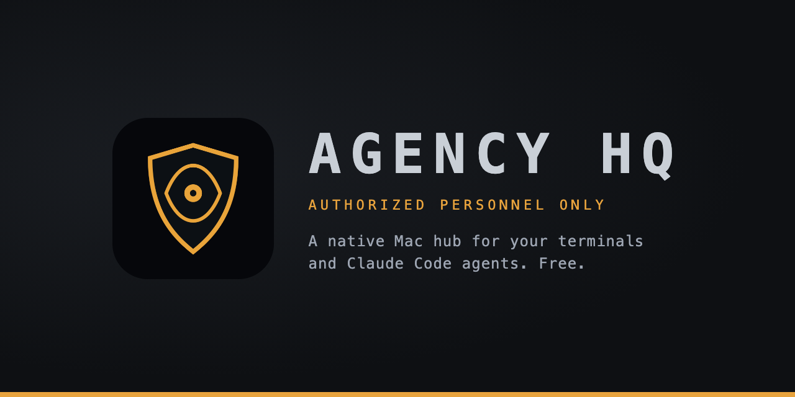

<p align="center">
  
</p>

<h1 align="center">Agency HQ</h1>

<p align="center">
  A native Mac hub for your terminals and Claude Code agents. Free and open source.
</p>

<p align="center">
  <a href="https://github.com/SadPidgeons/AgencyHQ/releases/latest"></a>
  
  
  <a href="LICENSE"></a>
  <a href="https://ko-fi.com/rollcoverage"></a>
</p>

Agency HQ keeps every terminal and every Claude Code session in one window, and tells you which one needs you. Run several agents at once, switch between them from the sidebar, and look away until an orange dot says one has gone quiet.

> [!NOTE]
> Agency HQ is not affiliated with or endorsed by Anthropic. It starts the `claude` command-line tool that you install yourself.

## Install

**Download:** grab `AgencyHQ.zip` from the [latest release](https://github.com/SadPidgeons/AgencyHQ/releases/latest), unzip it, and drag **Agency HQ** to Applications.

**First launch:** the app is not signed or notarized, so macOS will block it the first time.

1. Try to open the app once. macOS shows a warning.
2. Open **System Settings > Privacy & Security**.
3. Scroll to the Security section and click **Open Anyway**, then enter your password.

macOS offers the button for about an hour after a blocked launch. See Apple's guide to [opening an app from an unknown developer](https://support.apple.com/guide/mac-help/open-a-mac-app-from-an-unknown-developer-mh40616/mac).

**Requirements:** macOS 13 or later.

## Features

- [x] Real terminals (zsh login shells) in one window, powered by [SwiftTerm](https://github.com/migueldeicaza/SwiftTerm)
- [x] **Claude terminals**: pick a project folder and Agency HQ starts `claude` there; when it exits you land in a normal shell
- [x] **Attention dots**: an orange dot appears on a terminal when its output has gone quiet or its process has finished while you were looking elsewhere
- [x] **Quick terminal**: paste a command, review it, run it; the terminal closes itself a moment after it finishes
- [x] **Phone alerts (optional)**: get a push through [ntfy](https://ntfy.sh) when a terminal needs you; off by default
- [x] **Keep awake**: one toggle (toolbar or menu bar) runs `caffeinate -dims` while the app is open
- [x] **Review findings panel**: shows code-review findings from a JSON file (see below)
- [x] Rename terminals by double-clicking them
- [x] A heads-up when more than two Claude terminals are open

### Keyboard shortcuts

| Shortcut | Action |
| --- | --- |
| `Cmd+T` | New terminal |
| `Shift+Cmd+N` | New Claude terminal |
| `Shift+Cmd+R` | Quick terminal |

### Phone alerts

Open **Agency HQ > Settings** (`Cmd+,`), turn on ntfy alerts, and enter your topic. Install the ntfy app on your phone and subscribe to the same topic. Use the default `ntfy.sh` server or your own.

- Only the terminal's title is sent, for example "Claude: myproject may be waiting for you" (shortened to 80 characters). Programs can set a terminal's title, so it may show a folder or command name. Terminal output is never sent.
- The server must use `https`.
- At most one alert of each kind (waiting, finished) per terminal per minute.
- On the public `ntfy.sh` server, anyone who knows your topic name can read it. Pick a long, hard-to-guess name.
- Off by default. The app sends nothing until you turn it on.

### Review findings

Open **Review findings** in the sidebar to see findings from a file at:

```
~/Library/Application Support/AgencyHQ/findings.json
```

The app re-reads the file every few seconds. Format:

```json
{
  "title": "Code review",
  "findings": [
    {
      "file": "Sources/App.swift",
      "line": 42,
      "summary": "One-sentence description of the problem.",
      "scenario": "Optional: what input leads to what wrong result.",
      "verdict": "CONFIRMED"
    }
  ]
}
```

`file` and `summary` are required; the rest are optional. Ask your Claude session to write review results in this format.

## Build from source

You need macOS 13+ and a Swift 5.9+ toolchain (Xcode or the Command Line Tools). The app is built with the Command Line Tools.

```sh
git clone https://github.com/SadPidgeons/AgencyHQ.git
cd AgencyHQ
./scripts/bundle.sh
open AgencyHQ.app
```

This builds `AgencyHQ.app` in the project folder. Drag it to Applications to keep it. Because it is unsigned, see the first-launch steps under [Install](#install).

To run it straight from the terminal while developing, use `swift run`.

## FAQ

**Does Agency HQ send my data anywhere?**
No, unless you turn on the optional ntfy phone alerts. Then it sends the terminal's title (never its output) to the ntfy server you choose. Otherwise it runs local shells, reads one local JSON file, and makes no network connections.

**Does it need Claude Code?**
Only for Claude terminals. Regular terminals work without it.

**Why does macOS warn me when I open it?**
The app is not signed or notarized because that requires a paid Apple Developer account. See [Install](#install).

## Contributing

Bug reports and pull requests are welcome. See [CONTRIBUTING.md](CONTRIBUTING.md).

## Support

Agency HQ is free and always will be. If it saves you time and you want to chip in, you can [buy me a coffee on Ko-fi](https://ko-fi.com/rollcoverage). Entirely optional.

## License

[MIT](LICENSE). Built on [SwiftTerm](https://github.com/migueldeicaza/SwiftTerm), also MIT licensed.

---

Made by [Nicholas McCandless](https://www.linkedin.com/in/nicholas-mccandless/), Founder of [RollCoverage.com](https://rollcoverage.com).
